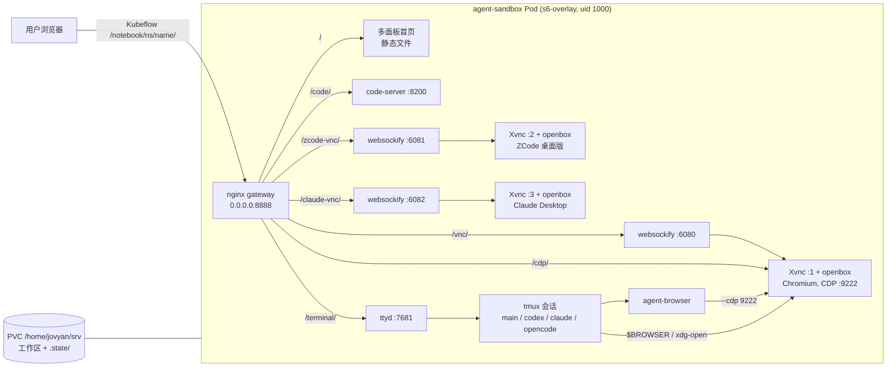

# Agent Sandbox

状态：已实现（2026-10-25）。这是一个**独立的** all-in-one agent 工作区镜像，不依赖 kubeflow 的构建体系；Kubeflow 特异性适配（registry 接入、集群验证）后续以薄镜像层单独做。linux/arm64 已在本地构建，并通过 `smoke-test.sh` 和 `ui-test.mjs` 的全部检查；linux/amd64 在 qemu 下验证了所有下载、校验和以及 Chromium 安装，运行时检查需要在真实 amd64 环境（CI）上跑（见 §9）。

参照 [agent-infra/sandbox](https://github.com/agent-infra/sandbox)（下文简称 AIO）的使用体验，做了一个单容器 agent 工作区镜像。打开后是一个多面板首页，VS Code、浏览器、终端和各个 coding agent 并排显示：

- 面板可以显示、隐藏、最大化、拖动调整大小，也可以拖动交换位置；
- 浏览器跑在 VNC 里，人能看到；agent 通过 CDP 和 agent-browser 操作的就是同一个浏览器。

没有直接 `FROM` AIO：

- 它的镜像是闭源成品；
- 它必须以 root 启动、用 supervisord、默认用户是 `gem`，而且不支持 `NB_PREFIX`；
- 它带了很多我们用不上的组件。

所以这里只复刻 AIO 的设计，代码全部自己写，没有拷贝 AIO 镜像里的文件。实现完全按仓库约定来：

- 唯一的外部依赖是已发布的基础镜像 `terencelau/kubeflow:kubeflow-ubuntu-24.04`（Ubuntu 24.04 + s6-overlay + jovyan/srv 布局），把它当普通基础镜像用；
- 用 s6 管理进程，以 uid 1000 运行；
- 原生支持路径前缀（`NB_PREFIX`，任何反向代理都适用，Kubeflow 只是其中一种）和 `.state` 持久化；
- 版本 pin 在 `versions/agent-sandbox.env`，构建入口是自己的 `agent-sandbox/Makefile` 和 `.github/workflows/agent-sandbox.yml`。

## 1. 范围

- **单容器、单端口**：对外只开 `8888`，所有路径挂在 `${NB_PREFIX}` 下（不设就是根路径）。鉴权、多租户、实例的创建和销毁交给部署平台（Kubeflow 或其他）。
- **持久化**：PVC 挂在 `/home/jovyan/srv`。各工具的状态、登录态和浏览器 profile 放在 `srv/.state/`，再用 `ln -s` 链接回 `$HOME`（§6）。
- **浏览器**：Chromium，agent 通过 CDP 和 agent-browser 操作。ego-lite 目前没有 Linux 版，等上游发布后再接入。
- **不做**：沙箱 HTTP API、MCP hub、SDK 兼容。将来需要时，可以把 AIO 单独发布的静态二进制 `aiod` 作为一个 s6 服务加进来。
- **不在本镜像里做的**：Kubeflow 特异性适配。后续在 kubeflow 目录里以 `FROM agent-sandbox` 的薄镜像层实现。

## 2. 架构



| s6 服务 | 进程 | 监听地址 |
| --- | --- | --- |
| `gateway` | nginx（非 root，配置渲染到 `/tmp/nginx`） | `0.0.0.0:8888` |
| `xvnc` / `wm` / `novnc` | Xvnc `:1`、openbox、websockify | `127.0.0.1:5901` / — / `127.0.0.1:6080` |
| `browser` | Chromium（Playwright 构建） | `127.0.0.1:9222` |
| `zcode-xvnc` / `zcode-wm` / `zcode-novnc` | Xvnc `:2`、openbox、websockify | `127.0.0.1:5902` / — / `127.0.0.1:6081` |
| `zcode-desktop` | ZCode 桌面版（Electron） | — |
| `claude-xvnc` / `claude-wm` / `claude-novnc` | Xvnc `:3`、openbox、websockify | `127.0.0.1:5903` / — / `127.0.0.1:6082` |
| `claude-desktop` | Claude Desktop（Electron） | — |
| `code-server` | code-server | `127.0.0.1:8200` |
| `terminal` | ttyd，入口是 `/opt/agent-sandbox/bin/session` | `127.0.0.1:7681` |

- `cont-init.d` 依次执行三个脚本：
  1. base 自带的 `01-copy-tmp-home`；
  2. `02-init-persistent-home`（§6）；
  3. `03-render-gateway`：按 `NB_PREFIX` 用 envsubst 渲染 nginx 配置，再跑 `nginx -t` 校验。
- legacy `services.d` 不支持声明依赖，所以依赖 X 的服务都先通过 `wait-for-display` 等 X 起来再启动。服务挂掉后由 s6 自动重启。
- Xvnc、openbox、websockify 的启动逻辑放在 `/etc/agent-sandbox/start-*`，两个 display 共用。
- 设置 `ZCODE_DESKTOP=false` / `CLAUDE_DESKTOP=false` 可以让对应 display 上的四个服务都只 `sleep`，各节省几百 MB 内存。

## 3. 浏览器

- **安装**：用 `npx playwright@${PLAYWRIGHT_VERSION} install --with-deps --no-shell chromium` 安装，然后链接为 `/usr/local/bin/chromium`。
  - Ubuntu 24.04 的 apt `chromium` 只是 snap 的过渡包，Google Chrome 只有 amd64 版本，都不能用。
  - 另装 `fonts-noto-cjk` 和 `fonts-noto-color-emoji`，中文和 emoji 才能正常显示。
- **启动参数**：
  - `--no-sandbox`：Kubeflow 通常不允许 `seccomp: Unconfined`，Chromium 自带的 sandbox 起不来；
  - `--disable-dev-shm-usage`：不需要修改 Notebook spec 来扩大 `/dev/shm`；
  - `--password-store=basic`：避免弹出 keyring 对话框；
  - `--disk-cache-dir=/tmp/...`：缓存不写 PVC；
  - `--disable-background*`：面板被隐藏时，页面不会被节流；
  - `--remote-debugging-address=127.0.0.1`：CDP 只监听本机。
- **启动前**：
  - 删掉 profile 里残留的 `Singleton*` 锁文件。Pod 重建后 hostname 会变，这些锁会让 Chromium 拒绝启动。
  - 用 jq 把下载目录 `srv/Downloads` 写进 Preferences。
- **窗口**：openbox 把所有窗口最大化并去掉标题栏，浏览器窗口始终铺满整个 display。

## 4. Agent

| agent | 安装方式 | 在首页里怎么用 |
| --- | --- | --- |
| Codex | GitHub release（musl），版本和 sha256 复用 `CODEX_CLI_*` | 面板就是 tmux 会话 `codex` |
| Claude Code（CLI） | `downloads.claude.ai` 下载的二进制，复用 `CLAUDE_CODE_*` | tmux 会话 `claude`（`terminal/?arg=claude`） |
| Claude Desktop | 官方 apt 仓库的 deb（`CLAUDE_DESKTOP_*`，从 pool 下载并校验 sha256） | **Claude 面板**：桌面版跑在 VNC `:3` 上 |
| OpenCode | 上游 `anomalyco/opencode` release（`AGENT_SANDBOX_OPENCODE_*`）。仓库里的 fork 只发布了 x64，而这个镜像只用 TUI，不需要 base-path 补丁 | tmux 会话 `opencode` |
| ZCode | 官方桌面版 deb（`ZCODE_*`，sha512 来自 CDN 上的 `latest.yml`） | 桌面版跑在第二个 VNC display 上，有单独的面板 |
| agent-browser | npm tarball（sha512）里自带的原生二进制，不需要 Node | 在任意终端里使用 |

- **ZCode**：官方没有发布 Linux CLI。桌面版 deb 里带了 CLI 的打包文件 `resources/glm/zcode.cjs`，但它缺少终端 UI（`@zcode/tui` 没有发布），所以（ZCode 面板同样是桌面版）：
  - ZCode 面板运行的是桌面版（`zcode-desktop`）；
  - `zcode` 命令用 Node 24（`/opt/node24`）运行 `zcode.cjs`，可以用于 `zcode -p`、`app-server`、`doctor` 等无界面场景；
  - CLI 查找 provider 配置的路径是 `glm/provider/`，所以把它链接到 `config/provider/`；
  - deb 注册的 `zcode://` 登录回调交给 `zcode-desktop` 包装脚本处理。它会加上容器里必需的启动参数，并把 URL 交给正在运行的实例。
- **Claude Desktop**：Linux beta，官方 apt 仓库（amd64/arm64）。镜像里：
  - 从 pool 下载 pin 版本的 deb 安装；`/etc/default/claude-desktop` 写 `CLAUDE_DESKTOP_ADD_REPO="false"`，阻止 postinst 在镜像里注册 apt 仓库；`--no-install-recommends` 跳过 Cowork 用的 QEMU（容器里没有 KVM，装了也用不了）；
  - `/usr/local/bin/claude-desktop` 是包装脚本：补上 `--no-sandbox --disable-gpu` 等容器必需参数，并在 `dbus-run-session` 里启动一个解锁的 gnome-keyring——应用的登录态走 libsecret，没有 keyring 就存不住；
  - `claude://` 深链接由它处理；登录打开的网页走 `$BROWSER`（共享 Chromium），回调也在容器内完成；
  - Cowork 需要 KVM 虚拟化，容器里不可用；Chat 和 Claude Code 会话正常。
- **终端会话**：ttyd 带 `--url-arg` 启动，`terminal/?arg=<name>` 进入同名 tmux 会话。
  - `session` 脚本只接受 `main`、`codex`、`claude`、`opencode` 这几个名字。
  - agent 退出后，会话里会留下一个 shell，面板不会直接关掉。
  - 刷新页面或者关闭面板都不会中断 agent；多个浏览器标签页看到的是同一个会话（tmux `window-size latest`）。
- **agent-browser 的 daemon socket**：`AGENT_BROWSER_SOCKET_DIR=/tmp/agent-browser`，socket 和 pid 文件放在本地 `/tmp`，不写到 PVC 上（NFS、JuiceFS 不支持 unix socket）；session、凭据库和加密 key 仍然保存在 `~/.agent-browser`，会被持久化。
- **agent-browser 包装脚本**：命令里没有 `--cdp`、`--auto-connect`、`--provider`、`--engine` 时，自动补上 `--cdp 9222`。`skills`、`install`、`connect` 等子命令原样透传。这样 agent 不会再起一个看不见、也没有任何登录态的 headless 浏览器。
- **`$BROWSER=/opt/agent-sandbox/bin/open-url`**：`xdg-open`、`codex login`、`gh auth login --web` 以及 ZCode 打开的链接，都通过 CDP 的 `PUT /json/new` 在共享的 Chromium 里新开一个标签页。OAuth 的 localhost 回调也就在容器内完成了。
- **首次启动时写入**（只在文件不存在时写）：
  - `~/.codex/AGENTS.md`、`~/.claude/CLAUDE.md`、`~/.config/opencode/AGENTS.md`：说明工作区位置、浏览器用法和禁止的操作；
  - agent-browser 的 skill stub，写到 `~/.claude/skills/` 和 `~/.codex/skills/`；
  - OpenCode 的 `"share": "disabled"`。

## 5. Gateway

| 路径（都带 `${NB_PREFIX}` 前缀） | 去向 |
| --- | --- |
| `/healthz`（无前缀和有前缀的都有） | 200 |
| `${NB_PREFIX}`（不带末尾斜杠） | 302 到 `${NB_PREFIX}/` |
| `/` | `/opt/agent-sandbox/dashboard/` |
| `/code/` | code-server（剥掉前缀后转发） |
| `/vnc/`、`/zcode-vnc/`、`/claude-vnc/` | websockify 以及 noVNC 的静态文件 |
| `/terminal/` | ttyd（用 `--base-path` 处理前缀，不剥前缀） |
| `/cdp/` | Chromium |

- WebSocket 相关设置写在 `nginx-proxy.conf`，每个 location 单独 include。原因是 nginx 的一条规则：location 里只要出现自己的 `proxy_set_header`，就会丢掉从 server 级继承的那些，`Upgrade` 头也就没了。第一版就是因此导致所有 WebSocket 都失败。
- **CDP**：
  - 转发时把 Host 改成 `localhost:9222`，因为 Chrome 会拒绝 Host 不是 localhost 或 IP 的请求；
  - 用 `sub_filter` 把 `ws://localhost:9222/` 改写成对外地址。在 HTTPS 的 ingress 后面（`X-Forwarded-Proto: https`），会改写成 `wss://`。
- **嵌入**：统一隐藏上游返回的 `X-Frame-Options` 和 `Content-Security-Policy`，所有应用都同源嵌入首页。
- **`absolute_redirect off`**：避免 nginx 把重定向改写成带内部端口的绝对地址。

## 6. 持久化（`srv/.state`）

| home 路径 | `.state/` 下 |
| --- | --- |
| `~/.codex` | `codex` |
| `~/.claude`（`CLAUDE_CONFIG_DIR` 指向这里，所以 `.claude.json` 也在这个目录里，不需要单独链接文件） | `claude` |
| `~/.config/opencode`、`~/.local/share/opencode`、`~/.cache/opencode`、`~/.local/state/opencode` | `opencode/{config,data,cache,state}` |
| `~/.zcode`（CLI 状态） | `zcode` |
| `~/.config/ZCode`（桌面版，启动前同样清理 `Singleton*` 锁文件） | `zcode-desktop` |
| `~/.config/Claude`（Claude Desktop 的数据，启动前清理 `Singleton*` 锁文件） | `claude-desktop` |
| `~/.local/share/keyring`（gnome-keyring；Claude Desktop 的登录态存在这里） | `keyring` |
| `~/.agent-browser` | `agent-browser` |
| `~/.config/sandbox-browser`（Chromium profile） | `browser` |
| `~/.local/share/code-server/{User,extensions}`、`~/.config/code-server` | `code-server/...` |
| `~/.config/gh` | `gh` |
| `~/.config/git`（没有 `~/.gitconfig` 时，`git config --global` 会写到这里） | `git` |
| `HISTFILE`（在 `/etc/profile.d/agent-sandbox.sh` 里设置） | `bash_history` |

浏览器下载的文件放在 `srv/Downloads`。`.home_initialized` 标记和 `HOME_TMP` 的复制逻辑与其他 kubeflow 镜像相同。

## 7. 首页

- 纯静态的 `index.html`、`style.css` 和 `app.js`，不需要构建步骤。所有面板地址都用相对路径（`new URL(".", location.href)`），在 `NB_PREFIX` 下不需要任何改写。
- **顶栏**：七个应用按钮（VS Code、Browser、Terminal、Codex、Claude、OpenCode、ZCode），每个按钮带健康状态点（每 15 秒探测一次）；四个布局按钮：auto、columns、rows、focus；一个 About 按钮，显示从 `status.json` 读到的组件版本。
- **面板**：标题栏上有刷新、新标签页打开、最大化/还原（双击标题栏也可以）、隐藏四个按钮。
  - 拖动面板之间的分隔条调整大小，双击分隔条恢复均分；
  - 拖动面板标题栏到另一个面板上，两者交换位置。
- **快捷键**：`Alt+1…7` 切换对应面板的显示，`Alt+Enter` 最大化当前面板。所有 iframe 同源，快捷键在 iframe 内的 window 上用 capture 阶段监听，焦点在 VS Code 或终端里时也有效。
- **状态**：可见面板、顺序、布局和分隔条比例都存在 `localStorage`。读写都包了 try/catch，存储不可用时退回默认布局。也可以用 `?apps=code,browser&layout=columns&max=browser` 直接指定。
- **iframe 从不在 DOM 中移动**：移动会触发 iframe 重新加载。所有面板都是绝对定位，切换布局只重新计算位置；隐藏的面板保留原来的尺寸，只设成 `visibility:hidden`，避免 noVNC 看到 0×0 的视口。拖动时在 iframe 上面加一层透明遮罩，否则鼠标事件会被 iframe 吞掉。
- **`display.html`**：一个自己写的极简 noVNC 页面，用 `?socket=vnc/websockify`、`?socket=zcode-vnc/websockify` 或 `?socket=claude-vnc/websockify` 选择连哪个 display，比完整的 `vnc.html` 简洁。三个桌面应用面板（Browser、ZCode、Claude）都用它。
  - 远端分辨率跟随面板尺寸（`resizeSession`），窗口始终铺满。
  - 面板小于 640×400 时改为缩放显示。这也防止了一个反馈循环：如果在 sandbox 自己的浏览器里打开首页，Browser 面板会不断缩小自己所在的 display。
  - 断线后自动重连，退避时间逐步增加。
  - 剪贴板：
    - 远端复制的文本写入本地剪贴板；
    - 按 Ctrl/Cmd+V 时，先把本地剪贴板推到远端，再发送 Ctrl+V；
    - macOS 上的 Cmd+C、Cmd+V、Cmd+A 等快捷键转换成 Ctrl 组合键。

## 8. 文件布局

```text
agent-sandbox/
├── DESIGN.md
├── Dockerfile         # FROM terencelau/kubeflow:kubeflow-ubuntu-24.04（可配 BASE_IMAGE/BASE_IMAGE_TAG）
├── Makefile           # make build / push / smoke
├── README.md
├── smoke-test.sh      # 容器级检查：路由、WebSocket、进程、CLI、agent-browser、持久化
├── ui-test.mjs        # 首页交互检查（用宿主机上的 headless Chrome）
├── opt/               # → /opt/agent-sandbox
│   ├── bin/{session,agent-browser,open-url,zcode-desktop,claude-desktop}
│   ├── agent-config/AGENTS.md
│   └── dashboard/{index.html,style.css,app.js,display.html}
└── s6/                # → /etc
    ├── cont-init.d/{02-init-persistent-home,03-render-gateway}
    ├── services.d/{gateway,xvnc,wm,novnc,browser,code-server,terminal,zcode-*,claude-*}/run
    └── agent-sandbox/{nginx.conf.tmpl,nginx-proxy.conf,openbox-rc.xml,tmux.conf,profile.sh,
                       runtime-env,start-xvnc,start-openbox,start-websockify,wait-for-display}
```

- 构建：`make -C agent-sandbox build`；CI 是独立的 `.github/workflows/agent-sandbox.yml`（push 到 master 且 agent-sandbox 有改动时自动构建，也可手动触发、可选多架构）。
- 镜像名：`terencelau/agent-sandbox`，tag `ubuntu-24.04-r${AGENT_SANDBOX_IMAGE_REVISION}` 和 `latest`。
- 版本 pin 都在 `versions/agent-sandbox.env`（其中 codex / claude-code 与 `versions/kubeflow.env` 的 kubecode bundle 数值相同，目前手工同步）：
  - `AGENT_SANDBOX_*`（Node 24、OpenCode）
  - `ZCODE_*`
  - `AGENT_BROWSER_*`
  - `PLAYWRIGHT_VERSION`
  - `NOVNC_*`
  - `TTYD_*`
- 镜像体积约 6.3 GB（未压缩，base 是 1.6 GB）。大头是 Chromium 及其依赖、ZCode 桌面版、code-server 和各个 CLI。
- 运行资源：建议至少 2 CPU、4 Gi 内存；常驻 ZCode 桌面版并同时运行多个 agent 时建议 8 Gi。

## 9. 测试

```bash
make -C agent-sandbox build TARGETPLATFORM=linux/arm64
make -C agent-sandbox smoke
docker run -d --name sbx -p 127.0.0.1:18889:8888 -e NB_PREFIX=/notebook/a/b terencelau/agent-sandbox:latest
node agent-sandbox/ui-test.mjs http://127.0.0.1:18889/notebook/a/b/
```

本地已验证：

- **arm64**（colima）：`smoke-test.sh` 和 `ui-test.mjs` 全部通过。
  - `smoke-test.sh` 检查了：gateway 各路由；四条 WebSocket 都能升级；所有内部端口只监听回环地址；所有进程都以 jovyan 运行；各 CLI 能执行 `--version`；agent-browser 能驱动 VNC 里的浏览器；`open-url`；容器重建之后各项状态和登录态都还在。
  - 另外手动截图确认：VS Code、Browser（agent 打开的网页实时显示）、Codex、Claude、OpenCode 的 TUI 和 ZCode 桌面版都能在首页正常工作；`NB_PREFIX` 为空（`/`）时各路由也正常。
- **amd64**：在 colima 的 qemu 下构建（qemu 先用 `tonistiigi/binfmt` 更新过，colima 自带的版本跑 Ubuntu 24.04 的 python 会段错误）。
  - 已验证：Node、Playwright 安装的 Chromium（amd64 上是 Chrome for Testing 156）、code-server、ttyd、noVNC、Codex、Claude Code、OpenCode 的下载和 sha256 校验都通过；ZCode x64 deb 的 sha512 和其中的关键文件、agent-browser 的 linux-x64 二进制都在宿主机上单独核对过。
  - 构建停在 CLI 的 smoke test：Claude Code 和 OpenCode 是 Bun 编译的二进制，在 qemu-user 下会段错误。这是模拟器的问题，在真实 amd64 机器（GitHub Actions）上不会出现。amd64 的运行时检查需要在 CI 或真实机器上跑 `smoke-test.sh`。

## 10. 已知限制

- 没有在真实的 Kubeflow 集群上验证过，还需要确认三件事：
  - ingress 后面的 WebSocket 能否正常升级；
  - PVC 的属组；
  - Notebook culler 的行为（它会探测 Jupyter 的 `/api/kernels`，而这个镜像没有 Jupyter，和仓库里现有的 code-server 镜像是同一个问题）。
- ZCode 没有终端 UI：官方桌面版 deb 里缺少 `@zcode/tui`，面板里运行的是桌面版。
- 浏览器和 ZCode 都以 `--no-sandbox` 运行，靠容器本身做隔离。
- Chromium 和 Electron 会因为没有 system dbus 而打印一些报错日志，不影响功能。
